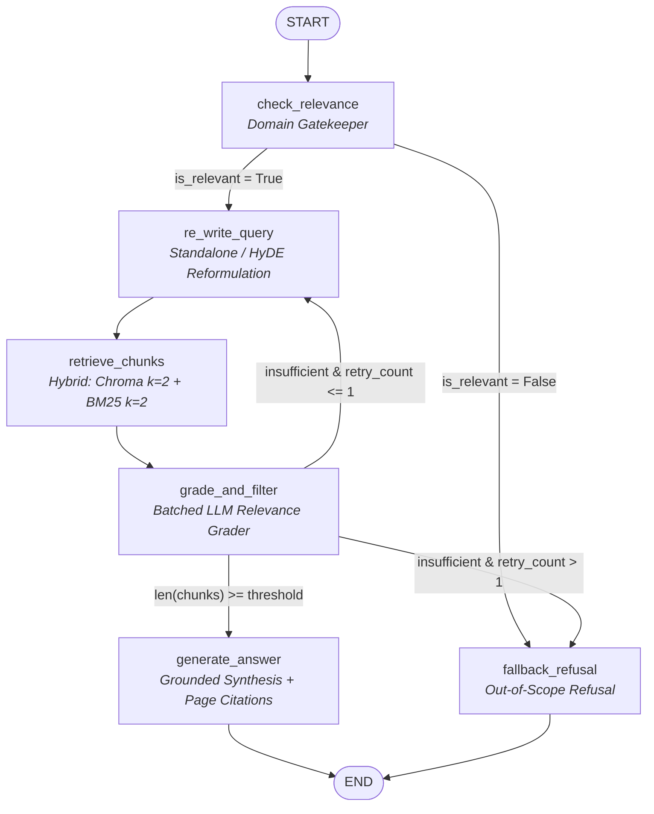

# NIST AI RMF Agentic RAG chatbot

 A small AI-powered question-answering system using LangGraph

## Project Structure

```text
nist_rag/
├── ingest.py           # Offline PDF parsing, chunking, and ChromaDB persistence
├── graph.py            # Pure LangGraph StateGraph definition with InMemorySaver
├── main.py             # Interactive multi-turn CLI chat loop (thread_id="demo_session")
├── eval.py             # Automated 4-scenario regression suite with isolated threads
├── pyproject.toml      # Project dependencies and pinned versions managed via uv
├── vectorstore/        # Persisted ChromaDB collection ("chunks", 768-dim Gemini embeddings)
└── README.md           # Setup, architecture, design decisions, limitations, and references
```

## Quickstart
```bash
# Install dependencies via uv (uses pyproject.toml) or pip:
uv sync
# pip install langgraph langchain-core langchain-google-genai langchain-chroma langchain-community rank-bm25 python-dotenv

# Create a .env file in the project root with:
# GOOGLE_API_KEY=your_api_key
# Note: If using a different provider instead of Google Gemini, add your provider's API key to .env
# and update the LLM and embedding model imports/initializations in ingest.py and graph.py.

python eval.py   # Run automated regression suite
python main.py   # Launch interactive CLI session
```

### Automated Evaluation Results (`eval.py`)
```text
[PASS] off_topic: 'best masala dosa in bluru'
[PASS] table_lookup: 'What are the exact suggested actions and GAI risks listed under GOVERN 1.1?'
[PASS] follow_up: 'Which AI actors are responsible for implementing those actions?'
[PASS] out_of_scope_ai: 'What exact fines or penalties does the EU AI Act impose for non-compliance?'
```

---

## 1. System Architecture: Offline vs. Online Phases

### Offline Ingestion Pipeline (`ingest.py`)
Prepares the static knowledge base once prior to query execution:
1. **Document Loading & Cleaning:** The NIST documents are directly loaded into the ./data folder, and not downloaded or processed via requests and other such libraries. This was done to simplify the process as there were only 2 documents. For cleaning, both the documents are parsed while stripping the white spaces but by preserving page-level metadata like source and page number for downstream citations. 

2. **Chunking:** We use Recursive Character Text Splitter which is structure aware, and can split based on blankness, rows, etc.

3. **Dual Index Construction:**
- **Dense Vector Store (ChromaDB):** Embeds chunks using `models/gemini-embedding-001` (`output_dimensionality=768`) and persists them to `vectorstore/`. This gives the semantic meaning of the text that was vector embedded.
  - **Lexical Index (BM25):** Loads persisted documents at startup to build an in-memory `BM25Retriever` (`k=2`) for exact keyword and subcategory ID matching (e.g., `GOVERN 1.1`, `CBRN`).

4. **Design choices:** A vector database like ChromaDB was chosen instead of a much simples vector indexes like FAISS because it stored metadata along with it rather than just storing embedding vectors like FAISS. This eliminates the need for a look-up table. Also, when persisted, the vectors are stored as is and multiple runs over ingestion is not required.
A Google gemini embedding model was used becasue it is free, and a lot simpler to use. THis provides a single key for both LLM call and embedding models. Additionally, it gives a dynamic option to re-size the dimensionality, offers API embeddings which requires zero compute overhead locally and scores high on retrieval benchmarks like MTEB.

---

### Online Inference Pipeline (`graph.py`)
Executes a stateful **Corrective RAG (CRAG)** workflow per user turn using LangGraph's `StateGraph` and `InMemorySaver` checkpointer (`thread_id`-scoped conversation memory):



- **Gatekeeper (`check_relevance`):** Evaluates the incoming query alongside the last two messages (`messages[-2:]`) to filter off-topic queries in a single LLM call before incurring retrieval overhead. If it is completely out of context, a flat refusal so this query is not re-written, thereby saving LLM calls.
- **Query Reformulation (`re_write_query`):** Resolves follow-up pronouns into standalone NIST-aligned queries on pass 1 (`retry_count == 0`) and generates concise HyDE/keyword expansions on pass 2 (`retry_count == 1`). This can be optimized further but for the MVP, I just kept it minimal. This handles insufficient context with HyDE, and also expands the acronymns. 
- **Hybrid Retrieval & Deduplication (`retrieve_chunks`):** Queries ChromaDB (`k=2`) and BM25 (`k=2`) in parallel and deduplicates overlapping chunks by `page_content`. So here, a maximum of 4 relevant chunks are considered. 
- **Batched Self-Correction (`grade_and_filter`):** Grades all retrieved chunks in a single LLM call, routing valid evidence to generation, triggering up to one query rewrite retry, or falling back to safe refusal. This filtering is based on LLM as a judge. 
- **Grounded Generation (`generate_answer`):** Synthesizes answers strictly from surviving chunks with explicit document name and page citations. The messages stored in the State context is also passed to pass in the context history. 

---

## 2. Current Limitations & Future Improvements

- **Multi-Column Table Splitting:** Character-based text splitting can sever wide table rows like passing one column below the other or not treating them as the same rows. *Next step:* Adopt layout-aware Markdown table parsing (e.g., `Docling` or `PyMuPDF4LLM`) combined with parent-document retrieval.
- **Cross-Page Comparison Recall (`k=2`):** Queries comparing concepts defined on separate pages can miss one side when top-`k` is kept low for speed. *Next step:* This can be improvised with improving the depthness (top-k = 2 currently) and introducing a re-ranker to fetch meaningful results to the top.
- **Volatile Session Memory:** `InMemorySaver` stores checkpoints in RAM, resetting conversation state once the process terminates. *Next step:* Swap in `SqliteSaver` or `PostgresSaver` for durable multi-session persistence.
- **Evaluation Coverage:** `eval.py` relies on substring matching against valid answer terms. For eg., YES in valid answer or so on. *Next step:* Integrate automated LLM-as-a-Judge metrics for faithfulness, context precision, and citation accuracy.

---

## 3. Declaration of AI Usage

In accordance with transparency best practices, AI assistance (Gemini) was used during development for the following specific tasks:
- **Architecture Visualization:** Generating and verifying the Mermaid state-transition diagram representing the online LangGraph workflow.
- **Debugging & Resilience:** Diagnosing transient API `503`/`504` timeout cascades, batching per-chunk LLM grading into a single call, and scoping conversation history slices (`messages[-2:]`) to prevent cross-turn state leakage.
- **Code Formatting & Modularization:** Refactoring the prototype script into clean, decoupled modules (`graph.py`, `main.py`, and `eval.py`) while preserving the core workflow design.

All system architecture decisions, prompt constraints, retrieval parameters, and evaluation test cases were designed, tested, and verified by the author.

---

## 4. References

1. **NIST AI RMF 1.0:** National Institute of Standards and Technology, *Artificial Intelligence Risk Management Framework (AI RMF 1.0)*, NIST AI 100-1, January 2023. https://doi.org/10.6028/NIST.AI.100-1
2. **NIST Generative AI Profile:** National Institute of Standards and Technology, *Artificial Intelligence Risk Management Framework: Generative Artificial Intelligence Profile*, NIST AI 600-1, July 2024. https://doi.org/10.6028/NIST.AI.600-1
3. **Corrective RAG (CRAG):** Yan, S.-Q., Gu, J.-C., Zhu, Y., & Ling, Z.-H., *Corrective Retrieval Augmented Generation*, arXiv:2401.15884, 2024. https://arxiv.org/abs/2401.15884
4. **LangGraph Agentic RAG:** LangChain Docs, *Agentic RAG*, https://docs.langchain.com/oss/python/langgraph/agentic-rag
5. **LangGraph Graph API (`StateGraph`):** LangChain Docs, *Graph API*, https://docs.langchain.com/oss/python/langgraph/graph-api
6. **LangGraph Persistence (`InMemorySaver`):** LangChain Docs, *Persistence*, https://docs.langchain.com/oss/python/langgraph/persistence
7. **LangChain Chroma & Google Gemini Embeddings Integration:** LangChain Docs, *Chroma Vector Store Integration (Google Gemini)*, https://docs.langchain.com/oss/python/integrations/vectorstores/chroma#google-gemini